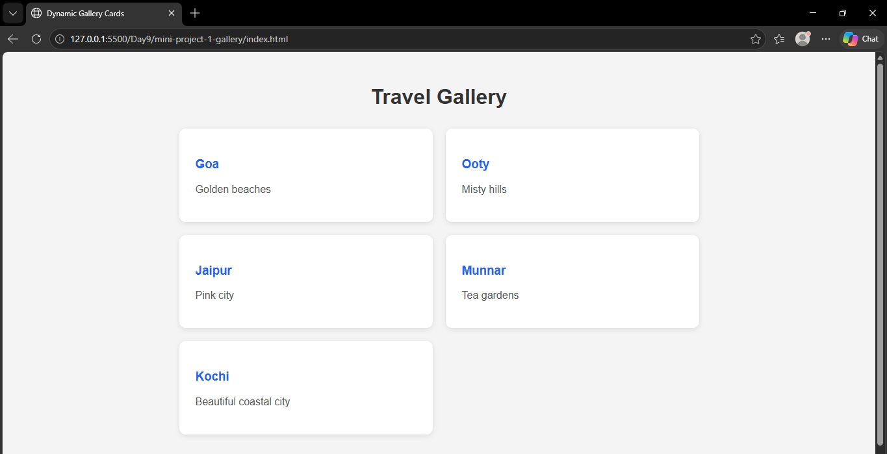
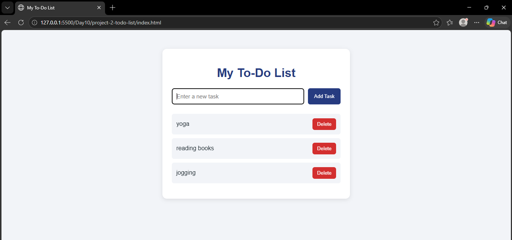

# HackGeniX Day 9 & Day 10 Projects

A collection of HTML, CSS and JavaScript practice exercises and mini projects completed during HackGeniX training.

## Projects

### 1. Dynamic Gallery Cards
- Created cards dynamically using JavaScript.
- Used arrays, objects and forEach().
- Used DOM manipulation.

### 2. Registration Form with Validation
- Name validation (minimum 3 characters).
- Email format validation.
- Phone number validation (10 digits).
- Password validation (minimum 8 characters).
- Displays error and success messages.

### 3. To-Do List with localStorage
- Add new tasks.
- Mark tasks as completed.
- Delete tasks.
- Save tasks using localStorage.
- Tasks remain after refreshing the browser.

### 4. Dark Mode
- Switch between light and dark themes.
- Save the selected theme using localStorage.
- Remember the selected theme after refreshing.

## Technologies Used
- HTML5
- CSS3
- JavaScript
- DOM Manipulation
- localStorage
- Git and GitHub

## How to Run
1. Clone or download this repository.
2. Open the required project folder in VS Code.
3. Open its index.html using Live Server.

## Author
Sadhatchi Shivaji

## Screenshots

### Dynamic Gallery

### Registration Form

### To-Do List

